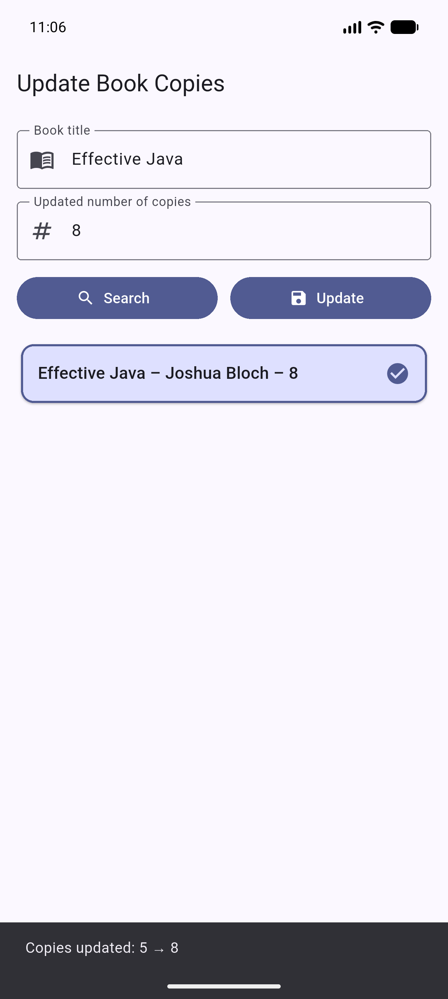
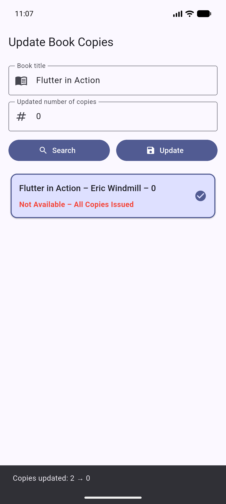

# Experiment 9: Firestore Data Update

24CS2016 - Building Applications using Flutter | URK23CS5014

## Aim

To develop a Flutter application that searches books in Google Cloud Firestore by title and updates the number of available copies based on user input, displaying the updated details immediately.

## Requirements

- The app never adds or deletes a book. It reads the `books` collection and changes only the `copies` field of an existing book with `update()`, never `set()`.
- Two text fields (book title, updated number of copies) and two buttons (Search, Update).
- An exact `where('title', isEqualTo: ...)` query runs first. If it returns nothing, the app fetches the collection and matches titles case-insensitively.
- Each match is shown as `Title – Author – Copies Available`. A single match is selected automatically; with several matches the user taps one. Selecting a book pre-fills its copies.
- `copies == 0` shows `Not Available – All Copies Issued` in red. No match shows `Book not found`. An empty title shows `Please enter a book title`.
- The Update button stays disabled until a book is selected. Copies must be a whole number from 0 to 1000.
- After an update the app reads the document again from the server, shows the new value and a `Copies updated: <old> → <new>` SnackBar.
- Permission and network errors show a readable message. The app reads the book from the server just before updating, so an offline update fails with a message instead of waiting in the local queue.

## Security rules

This app shares the `urk23cs5014-flutter-exp7` Firebase project with Experiments 7 and 8. A deploy replaces the whole rules file, so `firestore.rules` must stay the same in all three repos.

| Collection | Read | Create | Update | Delete |
| --- | --- | --- | --- | --- |
| `employees` | Until 30 Nov 2026 | Until 30 Nov 2026 | Until 30 Nov 2026 | Until 30 Nov 2026 |
| `books` | Yes | No | `copies` only, whole number from 0 to 1000 | No |

The `books` update rule uses `request.resource.data.diff(resource.data).affectedKeys().hasOnly(['copies'])`, which rejects any write that touches another field.

`tools/verify_rules.py` proves this with REST calls: updating copies works, while changing the title, creating a book, deleting a book and sending copies of -1, 1001 or text are all rejected.

## Tools

The books were stored by Experiment 8, not by this app.

- `tools/original_copies.json`: the copies of all 6 books before testing.
- `tools/save_original_copies.py`: creates that file.
- `tools/restore_copies.py`: puts every book back to those values and verifies them.
- `tools/verify_rules.py`: the rule checks above.

## How to run

```
flutter pub get
flutter run
flutter test
```

To test the rules or restore the books, run `python tools/verify_rules.py` or `python tools/restore_copies.py` (needs the `requests` package).

## Screenshots

| Update screen | Search result | Invalid copies |
| --- | --- | --- |
|  |  |  |

| Copies updated | Zero copies | Book not found |
| --- | --- | --- |
|  |  |  |
